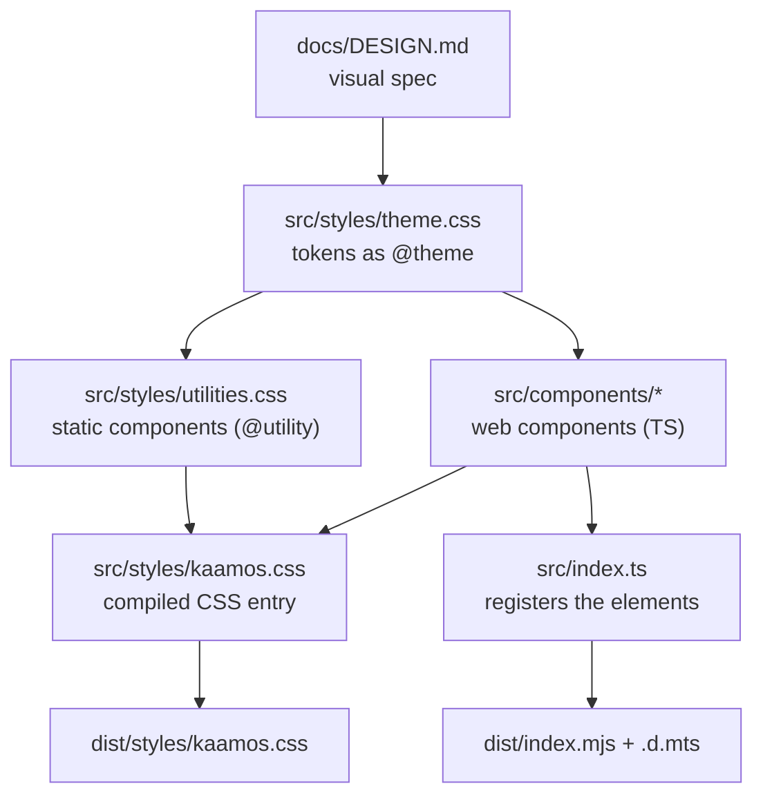

[Home](README.md) › Architecture

# Architecture

## Light DOM, no Shadow DOM

Every component renders into the **light DOM**: no `attachShadow()`. That is the key choice of the library, and it makes several things work for free:

- Global Tailwind classes style the component's internals.
- The inner native `<button>` / `<input>` is a real part of the page, so it takes part in `<form>`, `FormData`, validation and `<label>`.
- `popovertarget` and `commandfor` work, because the target id is in the same document as the inner button.
- Events of the inner field bubble up to the tag, which is what Angular's `ngDefaultControl` listens to.

The trade-off: styles are not encapsulated, so a page's CSS can reach inside a component. See [Decisions](decisions.md#light-dom-instead-of-shadow-dom).

## How a web component is built

Taking `<kaamos-button>` (`src/components/button/button.ts`) as the example:

1. `connectedCallback` creates the inner native `<button>` **once** (it can run again if the element is moved) and moves the tag's children inside it.
2. A list of `FORWARDED` attributes (`type`, `name`, `value`, `aria-*`, `popovertarget`, `commandfor`…) is copied to the inner element; `observedAttributes` keeps them in sync.
3. The look comes from Tailwind classes written **in full** in the source (`"h-9 px-4 bg-primary …"`), never composed from strings like `"bg-" + x`: Tailwind reads the file as text and only generates the classes it finds.
4. JavaScript properties (`variant`, `disabled`, `focus()`) mirror the attributes.

Components with richer behaviour (select, menu, tabs, command palette) follow the WAI-ARIA patterns described on their pages, and keep a **native element as the source of truth** where one exists (the `<select>` inside `kaamos-select`, the `<dialog>` of the command palette).

`src/index.ts` registers every element with a `define()` helper that skips tags already registered, so loading the bundle twice doesn't throw.

## CSS layers

| File            | Role                                                                                                                                                                                                                                                       |
| --------------- | ---------------------------------------------------------------------------------------------------------------------------------------------------------------------------------------------------------------------------------------------------------- |
| `theme.css`     | Tokens in a Tailwind v4 `@theme`: each variable becomes a utility class and a CSS variable. Tailwind's default palette and radii are removed.                                                                                                              |
| `fonts.css`     | `@font-face` for Inter, served locally.                                                                                                                                                                                                                    |
| `utilities.css` | Static components as `@utility` classes built with `@apply` on the token classes. They support Tailwind variants (`hover:`, `md:`) and are only emitted if used.                                                                                           |
| `kaamos.css`    | Entry of the compiled CSS for projects **without** Tailwind: imports Tailwind with `source(none)`, scans only `src/components`, and force-includes the static classes with `@source inline(...)`. Also sets base `display` values for the custom elements. |

### Static components as `@utility`

A badge doesn't need to "run", it only needs colours. So static components are CSS classes, not elements: no JavaScript, no runtime cost. Because no component uses them internally, Tailwind wouldn't find them; `@source inline(...)` in `kaamos.css` adds them to the compiled CSS anyway.

## Published package

`package.json` exports:

| Import                                                        | File                                              |
| ------------------------------------------------------------- | ------------------------------------------------- |
| `@kaamos/open-ui-web`                                         | `dist/index.mjs` (registers the elements) + types |
| `@kaamos/open-ui-web/kaamos.css`                              | compiled CSS, for projects without Tailwind       |
| `@kaamos/open-ui-web/theme.css`, `fonts.css`, `utilities.css` | source CSS, for projects with Tailwind            |

## Relationship with the other repos

- The tokens in `theme.css` use the same names as [open-design-tokens](https://github.com/kaamos-project/open-design-tokens), which was extracted from this library's `DESIGN.md`. Today `theme.css` is still a local copy; moving to the generated `tailwind.css` from the tokens package is the natural next step.
- [open-ui-flutter](https://github.com/kaamos-project/open-ui-flutter) implements the same components for Flutter, with the same look.

## See also

- [Getting started](getting-started.md)
- [Decisions](decisions.md)
- [Design spec](DESIGN.md)
